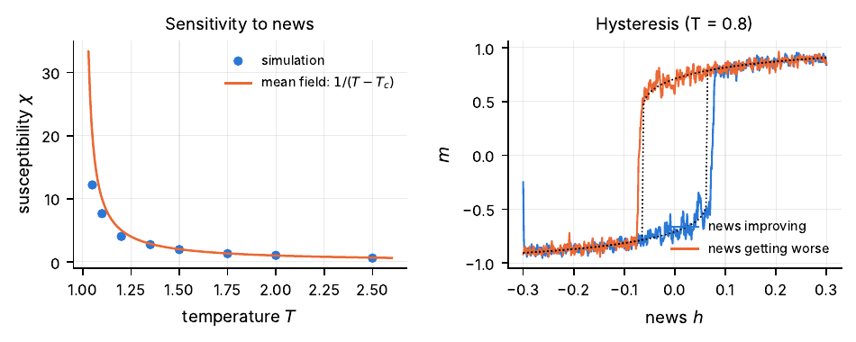
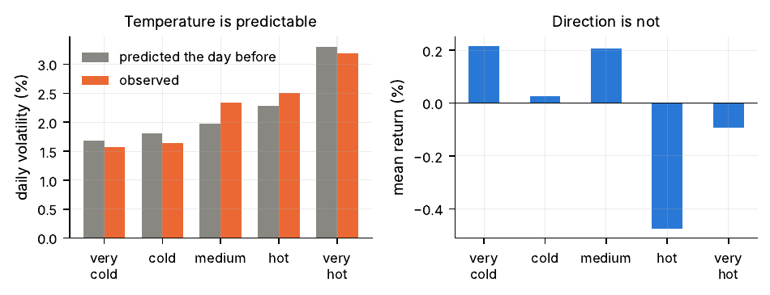

# Statistical physics of markets: four ideas

I'm a master's student in condensed matter physics. This repo is a side project where I take four ideas
from statistical mechanics that every physics student knows, apply them to real stock market data, and
check honestly where they work and where they don't.

The full write-up (20 pages, with all the derivations and figures) is in
[`document_en/Four_ideas_statistical_physics_markets.pdf`](document_en/Four_ideas_statistical_physics_markets.pdf).
There's also a Spanish version in [`documento/`](documento/Fisica_de_los_mercados.pdf).



## The four ideas

| Script | Physics | What I found in the data |
|---|---|---|
| `01_paseo_aleatorio.py` | Brownian motion, diffusion | Google's daily returns have no memory and their variance grows linearly with time, as for a random walk. But there were four days beyond 5σ in four years, where a Gaussian would give one every ~6900 years. |
| `02_temperatura.py` | heat bath with a fluctuating temperature | Volatility behaves like a slowly varying temperature. Mixing temperatures gives fat tails, and a GARCH "thermometer" fitted on the first half of the data predicts the second half's volatility well. The direction of the price, on the other hand, is not predictable at all. |
| `03_muelle.py` | overdamped Langevin / Ornstein–Uhlenbeck | The Nasdaq–S&P 500 spread looks mean-reverting (15-month half-life), but 12% of pairs of independent random walks look just as good. The "spring" is mostly the 2000 dot-com bubble. |
| `04_ising.py` | mean-field Ising model | Investors as spins that copy each other: spontaneous consensus (bubbles), sudden flips (crashes), a susceptibility that diverges at T<sub>c</sub>, and hysteresis, so a crash doesn't need terrible news. |



## Running it

You only need numpy, scipy and matplotlib. The data (daily Google prices 2004–2008 and monthly S&P 500 /
Nasdaq 1990–2022) ship with matplotlib, so nothing has to be downloaded.

```bash
pip install -r requirements.txt
python 01_paseo_aleatorio.py
python 02_temperatura.py
python 03_muelle.py
python 04_ising.py          # takes ~15 s
```

Each script saves its figures and prints every number quoted in the write-up. Figure labels are in Spanish
by default (saved to `figuras/`). For English labels (saved to `figures/`):

```bash
IDIOMA=en python 01_paseo_aleatorio.py
```

## Layout

```
comun.py            data loading and plot style, shared by the four scripts
01_ ... 04_*.py     one script per idea; each starts with a short outline of
                    the data types it uses and the steps it follows
figures/, figuras/  generated figures (English / Spanish labels)
img/                a few PNGs for this README
document_en/        LaTeX source + PDF of the write-up (English)
documento/          LaTeX source + PDF (Spanish)
```

The code comments are in Spanish (my first language); the write-up explains everything in English.

## References

The main ones are Mantegna & Stanley, *An Introduction to Econophysics*, and Bouchaud & Potters, *Theory
of Financial Risk and Derivative Pricing*. The full list is at the end of the PDF.